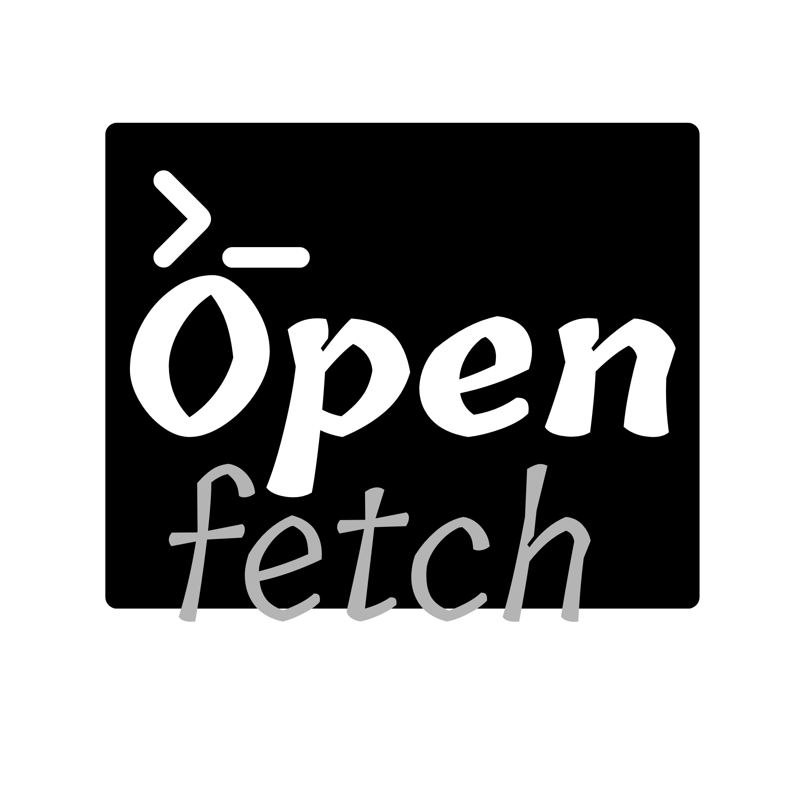

<p align="center">
  
</p>

# OpenFetch

A fast, customisable system info tool for Linux and macOS, written in Rust. Block-art
distro logos, themes, a live dashboard, animated and image logos.

Think Fastfetch, with more modules, themes you can write yourself, a documented
TOML config and JSON output.

> **Early release.** OpenFetch has only been run on a handful of machines so
> far. If something is missing or wrong on your hardware, please open an
> issue with the output of `openfetch --json --noip`.

```
                    ██                      ╭─ Software ──────────────────────────────────────╮
                   ████                     │ → Arch Linux x86_64                             │
                  ▄████▄                    │ → Linux 6.12.41-1-lts                           │
                 ▄██████▄                   │ → up 4 mins                                     │
                ▄████████▄                  │ → 2316 (pacman)                                 │
               ▄██████████▄                 │ → bash 5.3.3                                    │
              ▄████████████▄                │                                                 │
              ██████████████▄               │ → GNOME                                         │
            ▄  ▀▀████████████▄              │ → Mutter (X11)                                  │
           ▄████▄▄ ▀▀█████████▄             │ → MaterialYou                                   │
          ▄███████████████▀████▄            │ → Adwaita (24px)                                │
         ▄███████▀      ▀█▄ ▀███▄           ╰─────────────────────────────────────────────────╯
        ▄███████          █▄  ███▄          ╭─ Hardware ──────────────────────────────────────╮
       ▄████████          ███▄ ▀██▄         │ → AMD Ryzen 7 3750H (4C/8T) @ 2.30 GHz          │
      ██████████          ████▄  ███        │ → 9.13 GiB / 13.58 GiB (67%)                    │
     ██████████▀          ▀█████▄████       │ → 158.18 GiB / 224.43 GiB (70%) - btrfs (/)     │
    █████████▀              ▀█████████      │ → NCP004D 1920x1080@141.68Hz                    │
  ▄███████▀▀                  ▀▀███████▄    ╰─────────────────────────────────────────────────╯
```

(Real output is coloured; modules the machine does not have, such as GPU or
battery inside a VM, are simply left out.)

## Features

- **System detection:** distro and version, kernel, hostname, uptime, CPU model /
  cores / threads / frequency / usage / temperature, GPU, RAM and swap, mounted
  storage, motherboard, BIOS/UEFI (incl. Secure Boot state), desktop
  environment, window manager, display resolution, terminal, shell, package
  counts, battery (charge, health, cycles, time left), network interfaces and
  local IP, GTK/KDE theme, icons, cursor and font, monitor name with refresh
  rate (from EDID), load average, process count and init system.
- **Layouts:** titled **panels** (the default: bordered boxes with editable titles,
  arrow bullets and value-only rows), a classic **flat** list with labels, and a
  **compact** mode (small logo, essentials). The logo is dropped and lines are
  truncated on narrow terminals.
- **Themes:** `default`, `ocean`, `sunset`, `forest`, `nord`, `dracula`, `mono`,
  plus your own, optionally inheriting from a built-in one.
- **Logos:** Fedora, Arch, Debian, Ubuntu, openSUSE and a generic Tux, each in a
  large and a small size. On Unicode terminals they are drawn as solid block
  art (two coloured pixels per cell); elsewhere as ASCII art. Derivatives pick the right logo through `ID_LIKE`
  (Manjaro, Mint, Rocky, ...). Custom logos with colour markers.
- **Live dashboard:** `openfetch --tui` is a full-screen view with live CPU
  (total, history graph, per-core), memory, swap, disk and network panels next
  to the logo and the same boxes. The logo spins by default.
- **Your own picture or GIF as the logo:** `--image file.png` (PNG, JPEG, GIF),
  drawn with half-block characters. Animated GIFs play in `--animation` and
  `--tui`.
- **Animation:** off by default. Effects `rainbow`, `wave`, `pulse`, `spin` for
  any logo, GIF playback, or your own frame-based ASCII animation.
- **Graceful degradation:** every probe is optional. No root, no network, no
  external programs (one exception: the RPM package count calls `rpm`).
- **Unicode fallback:** pure ASCII bars/rules when the locale is not UTF-8 or
  with `--ascii`. 24-bit colours fall back to 256/16 colours automatically.
  `NO_COLOR` is respected and colour is off when output is piped.

## Build

Requires Rust (stable). Releases are built and tested with Rust 1.97. The
committed `Cargo.lock` only uses dependency versions that declare support for
Rust 1.75, but recent versions have not been built on a toolchain that old.

```sh
git clone https://github.com/Mayaiscool01/Openfetch openfetch && cd openfetch
cargo build --release --locked        # binary: target/release/openfetch
cargo test --locked                   # 135 unit tests + 23 end-to-end tests
./target/release/openfetch
```

Build dependencies per distro (just a Rust toolchain and a C linker):

| Distro | Packages |
| --- | --- |
| Debian / Ubuntu | `sudo apt install cargo gcc` |
| Arch | `sudo pacman -S rust gcc` |
| Fedora | `sudo dnf install cargo gcc` |
| openSUSE | `sudo zypper install cargo gcc` |
| macOS | `brew install rust` (plus the Xcode command line tools) |
| Anywhere | [rustup](https://rustup.rs) |

## Install

Prebuilt binaries for Linux and macOS (x86_64 and aarch64 / Apple Silicon) are
attached to each
[release](https://github.com/Mayaiscool01/Openfetch/releases): download the
archive for your machine, unpack it, and copy `openfetch` somewhere on your
`PATH` (for example `~/.local/bin`).

From source:

```sh
cargo install --path . --locked                 # to ~/.cargo/bin
# or system-wide
sudo make install                               # PREFIX=/usr/local by default
sudo make install PREFIX=/usr
sudo make uninstall
```

Then create your config:

```sh
openfetch --init-config      # writes ~/.config/openfetch/config.toml
```

## Packaging

| Target | How |
| --- | --- |
| Debian / Ubuntu `.deb` | `cargo install cargo-deb && cargo deb` |
| Fedora / openSUSE `.rpm` | `cargo install cargo-generate-rpm && cargo build --release && cargo generate-rpm` or `rpmbuild -ba packaging/openfetch.spec` |
| Arch | copy `packaging/PKGBUILD`, adjust `url`, run `makepkg -si` |
| Generic | `make install DESTDIR=/tmp/pkg PREFIX=/usr` |

The binary links only against libc, libm and libgcc, and nothing in it depends
on systemd. These packaging files are written but not yet exercised on those
distros.

## Usage

```
openfetch                    default output
openfetch --compact          small logo, essential modules, flat layout (-c)
openfetch --json             everything as JSON
openfetch --logo [NAME]      print only the logo (e.g. --logo arch)
openfetch --tui               live full-screen dashboard (q quits)
openfetch --interval MS      refresh interval for --tui (default 1000)
openfetch --image PATH       use a PNG, JPEG or GIF as the logo
openfetch --animation [FX]   animate the logo: rainbow | wave | pulse | spin | custom
openfetch --config [PATH]    PATH: use that config file; no value: show active config
openfetch --init-config      write a documented default config
openfetch --distro NAME      use another distro's logo in the normal output
openfetch --theme NAME       override the theme
openfetch --noip             hide IP addresses (before sharing a screenshot)
openfetch --ascii            ASCII only
openfetch --no-color         no colours
openfetch --list-themes | --list-logos
```

Animations run in place below your prompt until you press a key (or for
`animation.duration` seconds); the last frame stays in your scrollback. They
never run when output is piped, and if the terminal does not answer the cursor
position query OpenFetch falls back to static output.

## Sharing screenshots (`--noip`)

```sh
openfetch --noip
openfetch --tui --noip
```

`--noip` (or `hide_ip = true` under `[general]`) removes every IP address
from the output: the network and local-IP rows, and the whole `network`
object in `--json`. Nothing network-related is even collected. The default
panel layout does not show your username or hostname; the flat and compact
layouts do (the `title` module), so remove `title` from the module list if
you share those.

## Live dashboard (`--tui`)

```sh
openfetch --tui
openfetch --tui --interval 500 --theme nord
openfetch --tui --image ~/Pictures/me.gif
```

| Key | Action |
| --- | --- |
| `q` / `Esc` / `Ctrl-C` | quit |
| `t` | next theme |
| `s` | start / stop the logo effect |
| `p` | pause / resume updates |

The boxes from `[[sections]]` are shown without the modules that have a live
panel (memory, swap, disk, CPU usage and temperature, network, load, uptime,
processes). On a short terminal the least important panels are dropped first
(network, then disks, then the info boxes). Settings live under `[tui]`.

## Pictures and GIFs as the logo

```sh
openfetch --image ~/Pictures/logo.png            # still picture
openfetch --image ~/Pictures/cat.gif --animation # plays the GIF
openfetch --image logo.png --animation spin      # spins it
```

or permanently in the config:

```toml
[logo]
image = "~/Pictures/logo.png"
image_width = 36     # terminal columns
```

Each terminal cell shows two pixels (`▀` with a foreground and a background
colour), so the picture is low-resolution by nature: bold shapes and
transparent backgrounds work best, and a truecolor terminal is needed for it
to look right. Transparent pixels stay empty.

## Configuration

`~/.config/openfetch/config.toml` (or `$XDG_CONFIG_HOME/openfetch/config.toml`).
Everything is optional; `openfetch --init-config` writes a fully commented file.

```toml
# Panels: one titled box per [[sections]] entry. Rename, reorder, add, remove.
[[sections]]
title = "Software"
modules = ["os", "kernel", "uptime", "packages", "shell", "init", "break",
           "de", "wm", "theme", "icons", "cursor", "font", "terminal"]

[[sections]]
title = "Hardware"
modules = ["host", "cpu", "cpu_usage", "gpu", "memory", "swap", "disk",
           "battery", "break", "resolution", "network", "localip", "load"]
# bullet = "*"      # per-section bullet
# labels = true     # per-section "Label:" prefixes

# Used when layout.frame = "flat"
modules = ["title", "rule", "os", "kernel", "cpu", "memory",
           { label = "Motto", text = "hello" }, "break", "colors"]

[general]
theme = "nord"
unicode = "auto"        # auto | always | never
color = "auto"
cpu_usage = true        # false = ~7 ms startup instead of ~220 ms
hide_ip = false         # true = never show IP addresses (same as --noip)
hide_mounts = ["/boot/efi", "/efi"]

[layout]
style = "detailed"      # detailed | compact
frame = "panels"        # panels | flat
bullet = "→"
show_labels = false     # true = "→ Kernel: Linux 6.x"
logo_position = "left"  # left | right | none
gap = 3
margin = 1
bars = false            # usage bars for memory/swap/disk/CPU

[labels]
os = "Distro"

[logo]
name = "auto"
style = "auto"          # auto | block | ascii
# file = "~/.config/openfetch/logo.txt"
# colors = ["#ff5f6d", "#ffc371"]

[animation]
enabled = false
effect = "auto"         # auto | rainbow | wave | pulse | spin | custom
fps = 15
speed = 1.0
duration = 0.0

[tui]
interval_ms = 1000
effect = "spin"         # spin | rainbow | wave | pulse | custom | none
history = 60

[themes.mine]
base = "dracula"
key = "#ffb86c"
logo = ["#bd93f9", "#ff79c6"]
```

When labels are hidden, short hints keep values readable (`up 4 mins`,
`CPU 12%`, `(swap)`, `312 processes`, disk mount points).

**Modules:** `title rule break colors os host kernel uptime packages shell
terminal de wm resolution motherboard bios cpu cpu_usage cpu_temp gpu memory
swap disk battery network localip theme icons cursor font load processes init
locale` (a few aliases such as `ram`, `storage`, `firmware` work too). Order in the list is the order on screen; removing a
module disables it, and modules that are not listed are never probed.

**Colours:** names (`red`, `bright_blue`, `gray`), `#rrggbb`, `#rgb`, or `0`-`255`.

**Custom logos:** plain text. `$1`…`$9` switch to the n-th palette colour for
the text that follows (resets each line); `$$` is a literal `$`.

```
$1  /\
$1 /  \
$2/____\
```

**Custom animations:** `effect = "custom"` with `animation.file` pointing at a
text file whose frames are separated by a line containing only `%%`
(or inline `animation.frames = ["...", "..."]`). Each frame uses the same
colour markers as logos; `fps` and `speed` control playback.

## How it works / source layout

```
src/
  main.rs       wiring
  cli.rs        clap definitions
  config.rs     TOML config + defaults        default_config.toml (documented)
  theme.rs      colours, depth detection, built-in and custom themes
  system.rs     collects SystemInfo; DMI, firmware, battery; module names
  os.rs         os-release, kernel, uptime, shell, terminal, package counts
  cpu.rs        model (x86 and ARM/Apple parts), topology, usage, temperature
  memory.rs     RAM / swap
  gpu.rs        DRM sysfs + pci.ids lookup; Apple/ARM SoC GPUs
  storage.rs    mounts, pseudo-fs filtering, btrfs subvolume de-duplication
  network.rs    interfaces, default route, local IP
  desktop.rs    DE, WM / compositor, display resolution
  macos.rs      macOS probes (sw_vers, system_profiler, pmset, ioreg, route)
  logo.rs       logos (ASCII + block), colour markers, distro detection
  animation.rs  effects (incl. spin), GIF/custom frames, ratatui inline renderer
  bitmap.rs     image/GIF decoding, half-block pixel rendering
  tui.rs        live full-screen dashboard
  output.rs     rows, panels, bars, layout/composition, ANSI rendering
tests/cli.rs    end-to-end tests against the real binary
```

Information comes from `/proc`, `/sys`, `/etc/os-release`, environment variables
and `sysinfo`. Only the modules you list are collected, and the CPU usage sample
overlaps with the other probes.

## Performance

Measured on the release build (Ubuntu 24.04 x86_64 VM): about **7 ms** with
`cpu_usage = false` and **~223 ms** with the default config. The difference is
the 200 ms minimum interval `sysinfo` requires to compute a CPU usage figure.
Peak memory is roughly 14 MiB and the binary is about 2.3 MB. No background processes or threads are started.

## Platform notes and known limitations

- **macOS** support is new in 0.5.0. It is built and tested automatically on
  GitHub's Apple Silicon macOS machines, which are virtual and have no screen,
  GPU or battery, so the GPU, display and battery rows have not yet been seen
  working on a real Mac. Not available on macOS: CPU temperature, motherboard,
  icon/cursor/font themes. Packages count Homebrew formulae and casks and
  MacPorts. `system_profiler` makes the host, GPU and display rows slow
  (around half a second); remove those modules for a faster start. A
  downloaded binary may need `xattr -d com.apple.quarantine openfetch` before
  macOS lets it run.
- The macOS logo is the command-key symbol (⌘), not Apple's logo. Use
  `--image` if you want a different picture.

- **Resolution** is the connector's preferred DRM mode, not the scaled logical
  resolution. The refresh rate and monitor name come from the EDID's preferred
  timing and are shown only when that timing matches the reported mode.
- **Theme / icons / cursor / font** are read from GTK `settings.ini` and KDE
  `kdeglobals`/`kcminputrc`; on GNOME `gsettings` is used as a fallback.
- **Logos** are simplified drawings, not the official artwork. The block
  versions need a truecolor (or at least 256-colour) terminal to look right.
- **CPU temperature** depends on which hwmon/thermal sensors the kernel exposes;
  when none match, the line is omitted.
- **Apple Silicon / Asahi:** there is no DMI table, so Host comes from the
  device-tree model and Motherboard from the device-tree board id (e.g.
  `apple,j313`). The CPU model is derived from the core part numbers in
  `/proc/cpuinfo`, and the GPU from the `asahi` DRM driver's compatible string.
  Those paths are covered by unit tests with fixtures, but have **not** been run
  on real Apple hardware yet.
- **Image logos** use half-blocks only; there is no kitty/sixel graphics
  support yet, so pictures are coarse.
- **Spin** is a flat turn around the vertical axis (like a coin), not 3D. Text
  logos show their characters mirrored on the back side.
- **`--tui`** has only been exercised in a pseudo-terminal on an Ubuntu VM, not
  yet in real terminal emulators.
- Package counting covers dpkg, pacman, rpm, apk, xbps, flatpak and snap.
- Window manager detection falls back to scanning `/proc/*/comm`.

## Testing

```sh
cargo test --locked                  # unit + end-to-end
scripts/test-distros.sh              # build + test in Debian, Ubuntu, Arch, Fedora,
                                     # openSUSE and Alpine containers (podman/docker)
scripts/test-distros.sh fedora:latest
```

## Credits and license

Copyright (c) 2026 Maya. MIT licensed, see `LICENSE`. The large Ubuntu logo is adapted from
[neofetch](https://github.com/dylanaraps/neofetch) (MIT, notice in `NOTICE`);
the other logos are simplified originals. Distribution names and logos are
trademarks of their projects; OpenFetch is not affiliated with them.
